<div align="center">

# Gaming Stock Price Prediction

Apache Spark GBT pipeline predicting next-day close prices for 22 gaming stocks.<br>
**334,405 rows · Test R² = 0.9629 · RMSE = 10.08 · Gradio dashboard + MongoDB**

[](https://github.com/VenuBandi/gaming-stock-prediction/stargazers)

[](https://spark.apache.org)
[](https://python.org)
[](LICENSE)

</div>

<br>

<table>
<tr>
<td>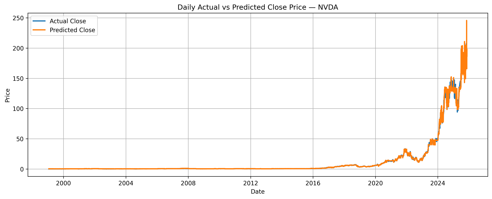</td>
<td>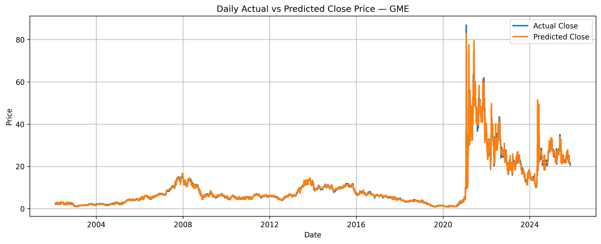</td>
</tr>
<tr><td align="center">NVDA — actual vs predicted</td><td align="center">GME — captures the 2021 meme spike</td></tr>
</table>

> [!NOTE]
> The model predicts **next-day close price** — a regression target, not a buy/sell signal. R² of 0.9629 reflects how well the model captures price structure from lagged technical features; it does not imply alpha in a live trading context.

## Results

| Split | Rows | RMSE | R² |
|:--|:--:|:--:|:--:|
| Train | 267,568 | 9.99 | **0.9629** |
| Test | 66,837 | 10.08 | **0.9629** |

Predictions cover the full history of all 22 tickers. Each chart below shows the daily actual vs predicted close price for one stock.

## Coverage — 22 Gaming Stocks

`AMD` `BILI` `CCOEY` `CRSR` `DKNG` `EA` `GME` `GRVY` `HUYA` `LOGI` `MSFT` `NTDOY` `NTES` `NVDA` `PLTK` `RBLX` `SE` `SONY` `SQNNY` `TCEHY` `TTWO` `U`

<details>
<summary>View all 22 prediction charts</summary>

<table>
<tr>
<td>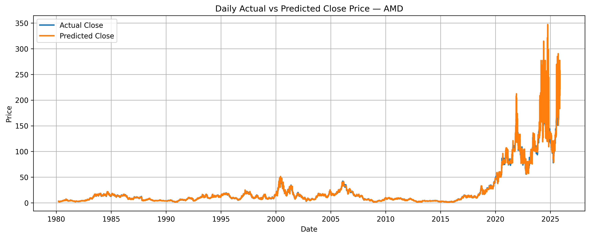</td>
<td>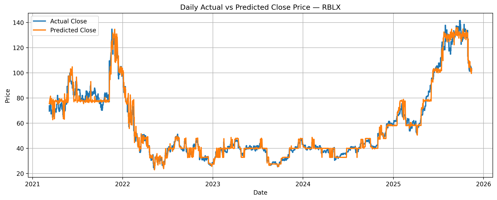</td>
</tr>
<tr><td align="center">AMD</td><td align="center">RBLX</td></tr>
<tr>
<td>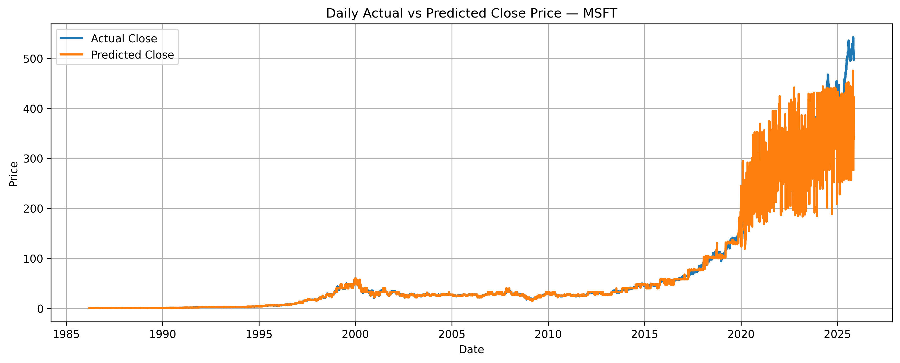</td>
<td>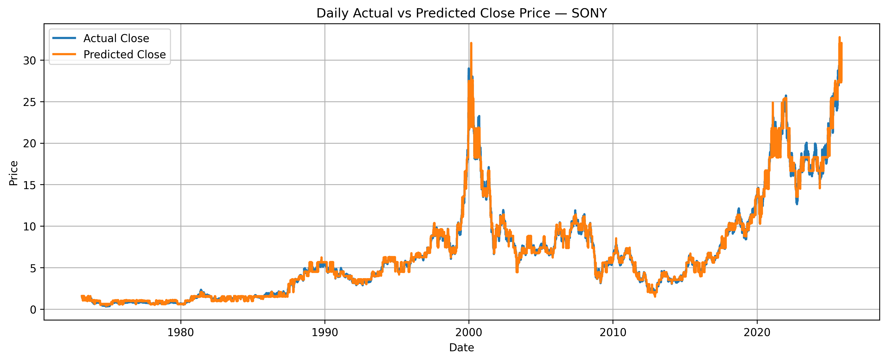</td>
</tr>
<tr><td align="center">MSFT</td><td align="center">SONY</td></tr>
<tr>
<td>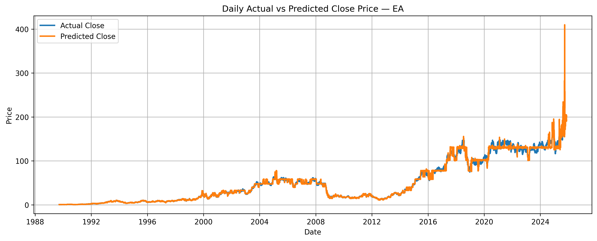</td>
<td>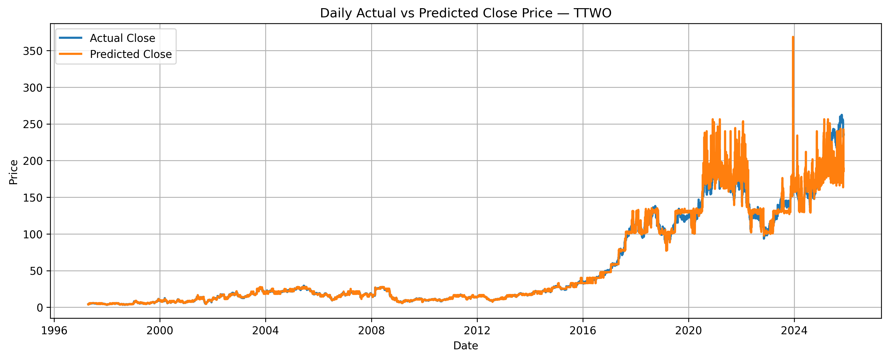</td>
</tr>
<tr><td align="center">EA</td><td align="center">TTWO</td></tr>
<tr>
<td>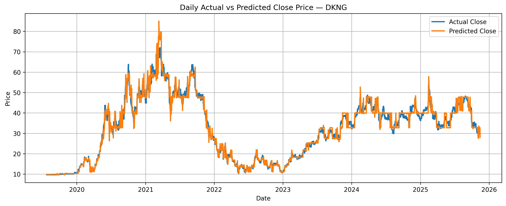</td>
<td>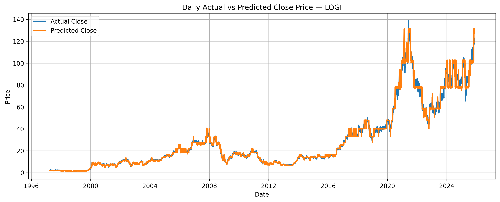</td>
</tr>
<tr><td align="center">DKNG</td><td align="center">LOGI</td></tr>
<tr>
<td>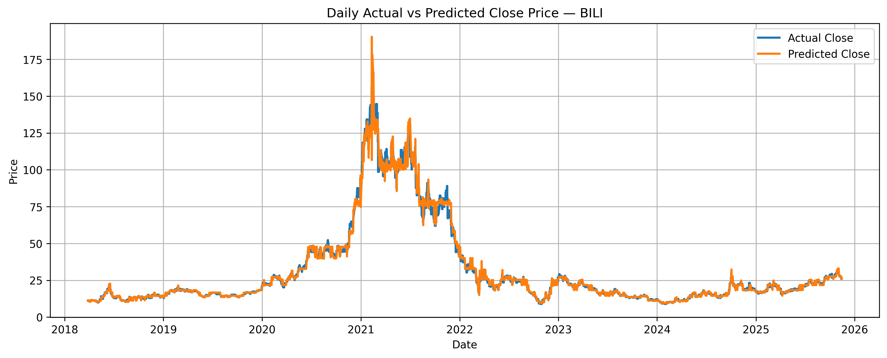</td>
<td>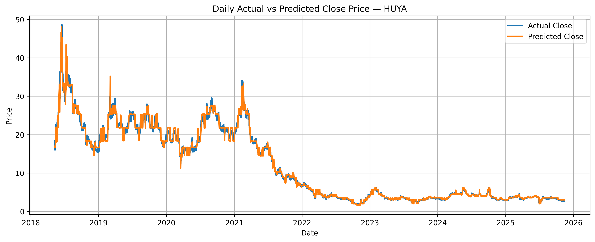</td>
</tr>
<tr><td align="center">BILI</td><td align="center">HUYA</td></tr>
<tr>
<td>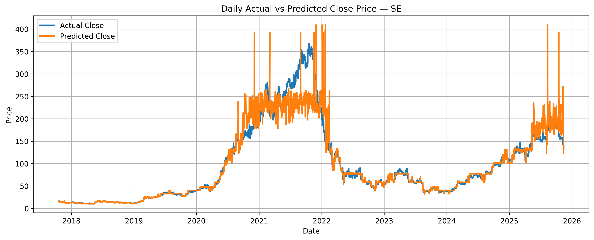</td>
<td>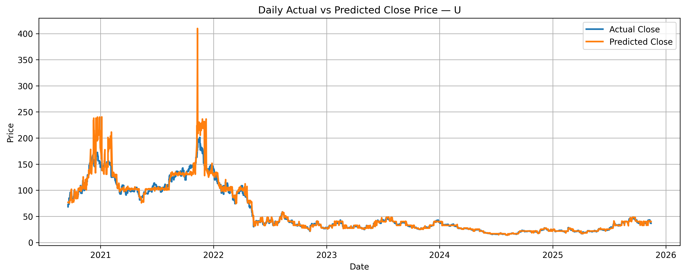</td>
</tr>
<tr><td align="center">SE</td><td align="center">U</td></tr>
</table>

</details>

## Pipeline

**1. Ingest** — Spark reads 22 cleaned CSV files into a single DataFrame (334,405 rows) partitioned by ticker.

**2. Feature Engineering** — Window functions compute per-ticker lagged features:

| Feature | Description |
|:--|:--|
| `Return` | Day-over-day % change in close price |
| `MA_7` | 7-day moving average |
| `MA_30` | 30-day moving average |
| `Volatility_30` | 30-day rolling standard deviation |
| `Range` | Daily high − low |
| `Volume_Change` | Day-over-day volume delta |

**3. Train** — Spark ML `GBTRegressor` (`maxDepth=5`, `maxIter=50`) on 80% of rows.

**4. Evaluate** — `RegressionEvaluator` on held-out 20% → R² 0.9629, RMSE 10.08.

**5. Serve** — 334,405 predictions stored in MongoDB; Gradio dashboard for live exploration.

## Notebooks

| Notebook | Description |
|:--|:--|
| `notebooks/00_data_inspection.ipynb` | PySpark EDA — loading 22 CSVs, schema inspection, null checks, data cleaning |
| `notebooks/Gaming_Stock_Prediction_Spark.ipynb` | Full GBT pipeline — feature engineering, training, evaluation, MongoDB + Gradio |

## Quick Start

```bash
git clone https://github.com/VenuBandi/gaming-stock-prediction
cd gaming-stock-prediction
pip install -r requirements.txt
jupyter lab notebooks/Gaming_Stock_Prediction_Spark.ipynb
```

Requires a running Spark session and local stock CSV data. See notebook for data loading paths.

## Stack

| Layer | Tools |
|:--|:--|
| Big Data | Apache Spark (SparkSession, Spark ML, Window functions) |
| Model | GBTRegressor (Gradient-Boosted Trees) |
| Data | yfinance · 22 gaming company stocks |
| Storage | MongoDB (334k prediction records) |
| Dashboard | Gradio + Plotly |
| Visualization | Matplotlib |

## License

MIT

---

<div align="center">

If this project was useful or interesting, a ⭐ helps others find it.

</div>
